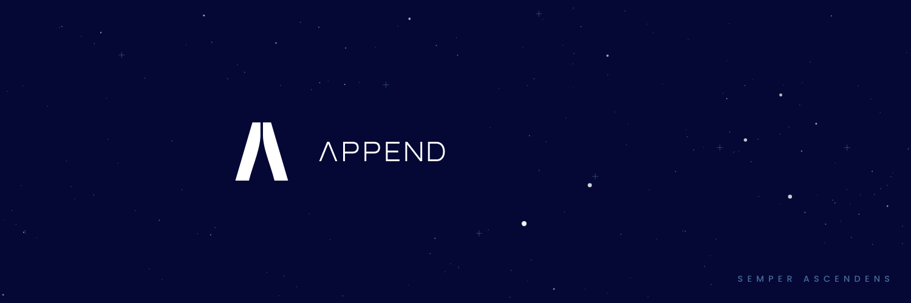

<a href="https://append.com.ar/en">
  
</a>

<div align="center">

<br/>

### Software for high-demand environments.

We design and build **platforms**, **infrastructure** and **artificial intelligence**<br/>
with the precision critical work demands.

<br/>

[](https://append.com.ar/en)
[](mailto:hello@append.com.ar)


<br/>

[About](#-about) · [Capabilities](#-capabilities) · [How we work](#-how-we-work) · [Products](#-products) · [Open source](#-open-source) · [Tech stack](#-tech-stack) · [Contact](#-lets-talk)

</div>

<br/>

## ◆ About

> **Few words. Systems that work.**

Append is a software engineering firm from Buenos Aires, founded in April 2024. We work where demands are high and the margin for error is minimal.

We build for others and we build our own. Every system we deliver adds to what we build next.

<table>
  <tr>
    <td width="33%" valign="top">
      <b>🎯 Mission</b><br/><br/>
      To turn precise engineering into our own capability.
    </td>
    <td width="33%" valign="top">
      <b>🔭 Vision</b><br/><br/>
      To create our own systems: technology developed from the south, on par with the most demanding industries in the world.
    </td>
    <td width="33%" valign="top">
      <b>🧭 Focus</b><br/><br/>
      Platforms, infrastructure and applied AI for operations where failure is not an option.
    </td>
  </tr>
</table>

### Values

| | |
| --- | --- |
| **Ascent** | Building the future, always upward. |
| **Addition** | Every piece adds and elevates. That is what *append* means. |
| **Precision** | Engineering as elegance. |

<br/>

## ◆ Capabilities

One standard at every layer. One engineering standard and a way of working you can verify.

<table>
  <tr>
    <td width="50%" valign="top">
      <h3>🧩 Platforms</h3>
      Custom software for operations that cannot fail.
      <br/><br/>
      <code>Services & backend</code> <code>Web & mobile</code> <code>Data</code> <code>Quality & testing</code>
    </td>
    <td width="50%" valign="top">
      <h3>☁️ Infrastructure</h3>
      Cloud, containers and pipelines built to run unsupervised.
      <br/><br/>
      <code>Cloud & containers</code> <code>Continuous delivery</code> <code>Monitoring & recovery</code> <code>Video processing</code>
    </td>
  </tr>
  <tr>
    <td width="50%" valign="top">
      <h3>📡 Hardware integration</h3>
      Cameras, sensors and field equipment connected natively to our own platforms: the software drives the hardware, not the other way around.
      <br/><br/>
      <code>Video capture</code> <code>Sensors & telemetry</code> <code>Field equipment</code> <code>Software control</code>
    </td>
    <td width="50%" valign="top">
      <h3>🧠 Applied AI</h3>
      Models from leading providers integrated into real operations, with engineering judgment.
      <br/><br/>
      <code>Model integration</code> <code>Agents & automation</code> <code>Evaluation & control</code>
    </td>
  </tr>
  <tr>
    <td colspan="2" valign="top">
      <h3>🤖 Automation with agents</h3>
      AI agents and people work together on the processes of each operation: we automate the repetitive and build clear decision flows, where every step is recorded.
    </td>
  </tr>
</table>

<br/>

## ◆ How we work

**From the right question to a running system.**

```
  01 DIAGNOSIS    ──▶  02 ARCHITECTURE  ──▶  03 BUILD           ──▶  04 OPERATION
  We understand        We define the         Short, verifiable       We measure,
  the problem and      system before         releases, with AI       maintain,
  its constraints.     writing code.         in the workflow.        improve.
        ▲                                                                 │
        └─────────────── operation feeds back into the decision ─────────┘
```

### What you can hold us to

| | Guarantee | In practice |
| :-: | --- | --- |
| 🧾 | **Traceable decisions** | Every technical decision is recorded with its context and its reasons. It can be explained, reviewed and picked up again. |
| ✅ | **Verifiable deliveries** | Short increments. Each delivery states what changes and how to check it. |
| ⚙️ | **Autonomous operation** | Systems that run without constant supervision: they detect failures, recover and report. |
| 🛠️ | **Controlled construction** | AI throughout the build, with clear steps and recorded decisions. We move fast and know exactly what we deliver. |

### Engagement models

| Model | What it means |
| --- | --- |
| **Turnkey project** | We define scope, architecture and deliveries, and take ownership end to end until the system is running. |
| **Dedicated team** | An Append team works continuously on your product, under our technical leadership and with deliveries agreed with you. |
| **Evolution & maintenance** | We take over systems in production, our own or third-party, to maintain, improve and evolve them. |

<details>
<summary><b>Industries we work in</b></summary>
<br/>

- **Critical infrastructure:** systems that cannot stop, where a failure has consequences beyond the screen.
- **Energy:** continuous, distributed operations, with field data that must arrive complete and on time.
- **Logistics:** flows that cross systems, parties and schedules, and need end-to-end traceability.
- **High-demand operations:** environments with strict confidentiality, precision and continuity requirements, where every technical decision must be explainable.

</details>

<br/>

## ◆ Products

**We also build our own.** Each product puts the engineering we deliver to the test.

| Product | What it does | Status |
| --- | --- | :-: |
| **Auraplay** | Records matches automatically and delivers the video to every player. Any sport that can be filmed. |  |
| **CRUX** | Passive sensing to protect critical infrastructure. |  |
| **Foundar** | Crowdfunding to drive young entrepreneurship in Latin America. |  |

<br/>

## ◆ Open source

### Gradus

**An outer-loop orchestration framework for coding agents.**
Gradus separates the authority to implement from the authority to accept.


Coding agents already write useful code. What they can't reliably do is decide whether that code is finished. Gradus moves that decision out of the agent:

> A coding agent can build whatever it wants, but whether the work is done is decided by tests a person approved before the work started, run by deterministic code the agent cannot influence.

The harness (today, Claude Code) runs the agent's inner loop. Gradus runs the loop around it: which phase comes next, which role works, with which tools, whether the work really passed its gate, and when to stop and call a person.

| | |
| --- | --- |
| 🧾 **Approved before building** | A person writes the intent; a verifier turns it into tests that must fail with nothing built. The person approves them, and their fingerprints are recorded. |
| 🔒 **Hermetic gate** | The orchestrator runs the approved tests with its own configuration and judges every approved test by ID. The project's config, plugins and stray files don't reach it. |
| ⚓ **Trust anchor** | Approvals, config, intent, roles and rules are held in memory and checked after every agent call. Any change stops the run. |
| 🧑‍🔧 **Five roles, least privilege** | Planner, verifier, builder, reviewer and scribe, each with its own tools and write scope, verified in code. |
| 🚪 **Fail closed** | When Gradus can't know, it takes the safe branch: the gate fails, the run escalates, cost is charged at the cap. |
| 🧬 **Measured, not assumed** | Mutation testing scores each gate, and results are reported with Wilson intervals instead of bare percentages. |

**Status.** Early and under active development. The current release closes the known paths for changing what gets judged; a sealed protection level, .NET at parity with Python and measured evidence from real runs are next on the roadmap. Known gaps are published, not hidden.

*Gradus* is Latin for "step": you don't climb to the next one without standing on the last.

<br/>

## ◆ Tech stack

<div align="center">

**Backend & data**<br/>


**Frontend**<br/>


**Infrastructure & DevOps**<br/>


</div>

<br/>

## ◆ Let's talk

<div align="center">

### Tell us what has to work.

Write to us and we will get back to you shortly.

[](mailto:hello@append.com.ar)
[](https://append.com.ar/en)

<br/><br/>

<sub>© 2026 Append · Software engineering from Buenos Aires · <b><i>SEMPER ASCENDENS</i></b></sub>

</div>
